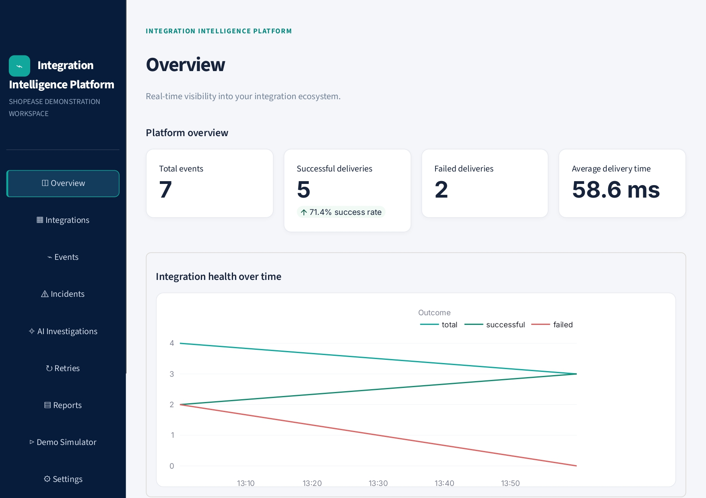
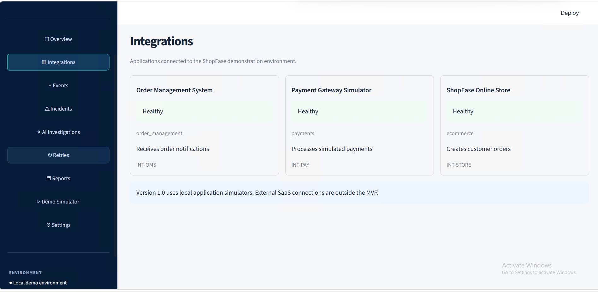
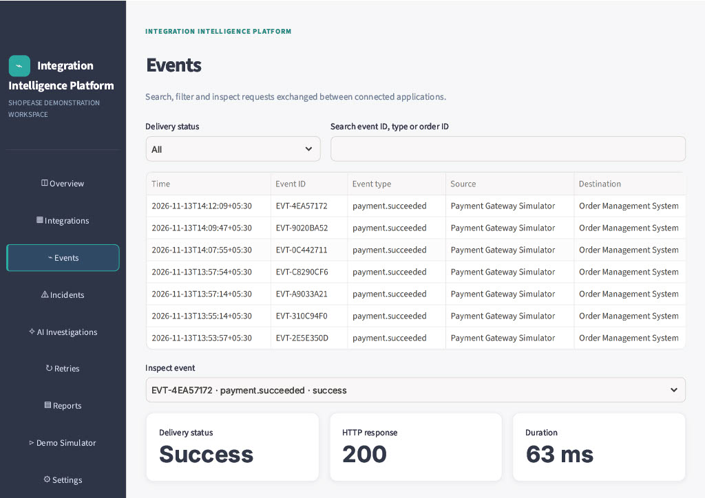
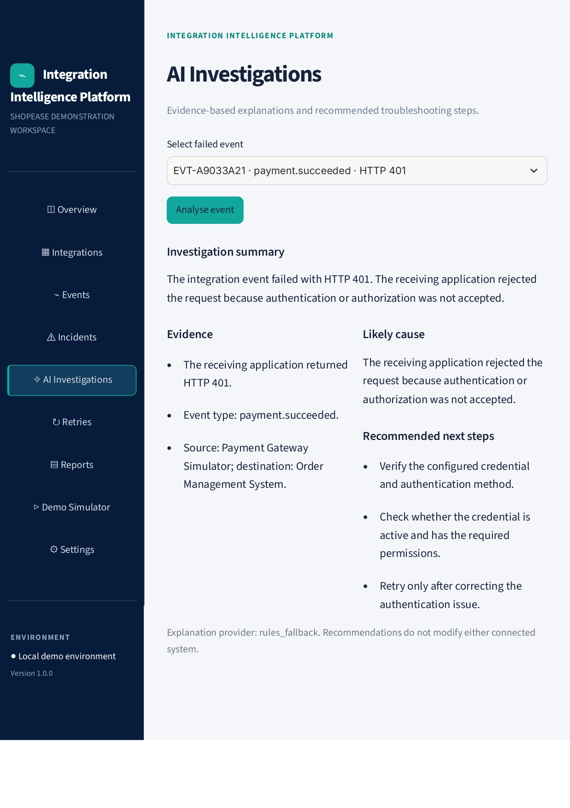
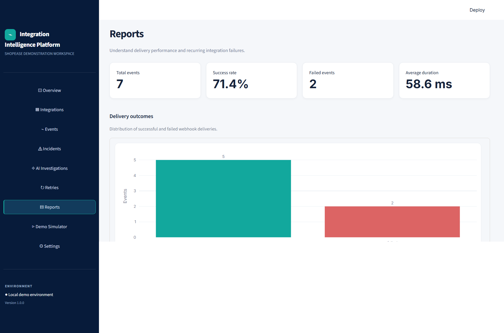
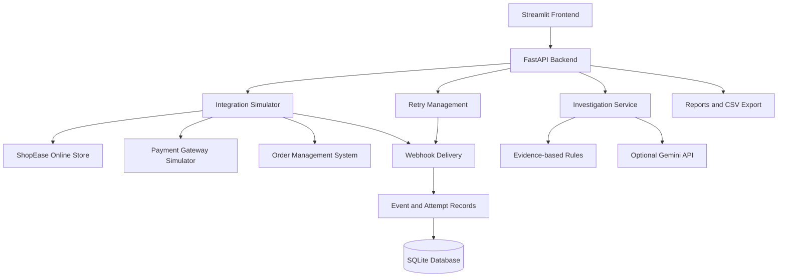

# Integration Intelligence Platform

**An integration monitoring and troubleshooting platform for modern business systems.**

Monitor webhook deliveries, investigate integration failures, inspect request and response payloads, and recover failed events through evidence-based troubleshooting.

[](https://www.python.org/)
[](https://fastapi.tiangolo.com/)
[](https://streamlit.io/)
[](tests/)

---

## Project overview

Modern businesses depend on multiple applications exchanging data through APIs and webhooks. When an integration fails, support and engineering teams need to understand what happened, identify the likely cause, and determine the appropriate corrective action.

The Integration Intelligence Platform demonstrates how these troubleshooting workflows can be brought together in one interface.

The application simulates an e-commerce order workflow involving three fictional systems:

- ShopEase Online Store
- Payment Gateway Simulator
- Order Management System

It captures webhook delivery activity, records failures, provides evidence-based investigation guidance, and supports manual retries.

**The project is designed as a local demonstration environment. It does not connect to real payment providers or process real payments.**

## Application screenshots

### 1. Overview dashboard

Monitor integration activity, delivery outcomes and connected systems.



### 2. Integrations

View the simulated business systems and their health status.



### 3. Events

Inspect integration events, HTTP responses, request payloads, response payloads and delivery attempts.



### 4. AI investigations

Review evidence-based failure explanations, likely causes and recommended troubleshooting steps.



### 5. Reports

Review delivery performance and export event data for further analysis.



---

## Key capabilities

| Capability | Description |
|---|---|
| Integration monitoring | Monitor activity across simulated business systems. |
| Webhook simulation | Reproduce application-to-application event delivery. |
| Event inspection | Examine request payloads, responses and HTTP status codes. |
| Failure simulation | Reproduce common integration failure scenarios. |
| AI investigations | Generate evidence-based troubleshooting explanations. |
| Retry management | Manually retry eligible failed events. |
| Delivery history | Review recorded attempts and their outcomes. |
| Reporting | Monitor delivery metrics and export CSV data. |

### Evidence-based investigations

The investigation engine uses available event evidence to explain integration failures.

It considers information such as:

- HTTP response codes
- Event type
- Source and destination systems
- Missing required fields
- Receiver error responses

Gemini API integration is optional. Deterministic rule-based explanations remain available without an API key.

The investigation engine provides recommendations; it does not autonomously modify connected systems.

## Architecture

The application uses a Streamlit frontend, FastAPI backend, SQLite database and dedicated simulation and investigation services.



## Technology stack

| Technology | Purpose |
|---|---|
| Python | Application logic and backend services |
| FastAPI | REST API and backend endpoints |
| Streamlit | Interactive user interface |
| SQLite | Local application data storage |
| Plotly | Dashboard visualizations |
| Pandas | Event data processing and CSV export |
| Pytest | Automated testing |
| Gemini API | Optional AI-generated explanations |

## Project structure

```text
integration-intelligence-platform/
│
├── app/
│   ├── services/
│   │   ├── investigation.py
│   │   └── simulator.py
│   ├── config.py
│   ├── database.py
│   ├── main.py
│   └── repository.py
│
├── frontend/
│   ├── views/
│   │   ├── dashboard.py
│   │   ├── integrations.py
│   │   ├── events.py
│   │   ├── incidents.py
│   │   ├── investigations.py
│   │   ├── retries.py
│   │   ├── reports.py
│   │   ├── settings.py
│   │   └── simulator.py
│   ├── api.py
│   ├── components.py
│   ├── dashboard.py
│   └── styles.py
│
├── data/
├── docs/
├── screenshots/
├── tests/
│   └── test_simulator.py
│
├── .env.example
├── .gitignore
├── requirements.txt
├── README.md
└── run.py
```

## Getting started

### Prerequisites

- Python 3.11 or newer
- Git
- Windows, macOS or Linux

### Installation on Windows

Clone the repository:

```powershell
git clone https://github.com/mohinikale2102-art/integration-intelligence-platform.git

cd integration-intelligence-platform
```

Create and activate a virtual environment:

```powershell
python -m venv .venv

Set-ExecutionPolicy -Scope Process -ExecutionPolicy Bypass

.\.venv\Scripts\Activate.ps1
```

Install dependencies:

```powershell
python -m pip install -r requirements.txt
```

Configure the environment:

```powershell
Copy-Item .env.example .env
```

### Optional Gemini configuration

Gemini is optional.

To enable Gemini-generated investigation explanations, configure your API key in the local `.env` file:

```text
GEMINI_API_KEY=your_api_key_here
GEMINI_MODEL=gemini-2.5-flash
```

Never commit `.env` or expose your API key publicly.

### Run the application

```powershell
python run.py
```

Open the application:

- **Streamlit dashboard:** http://localhost:8501
- **FastAPI documentation:** http://127.0.0.1:8000/docs

To stop the application, press `Ctrl + C` in the terminal.

## Demonstration workflow

Follow this workflow to explore the platform:

1. Open the Demo Simulator.
2. Create an order using the successful delivery scenario.
3. Generate a missing-required-field failure.
4. Open Events and inspect the failed event.
5. Review its request and response payloads.
6. Open AI Investigations and generate an evidence-based explanation.
7. Open Retries and retry an eligible failed event.
8. Inspect the delivery attempt history.
9. Review the results in Dashboard and Reports.

Additional scenarios can be used to explore authentication failures, receiver timeouts, duplicate deliveries and declined payments.

## Failure scenarios

| Scenario | Simulated result |
|---|---|
| Successful delivery | HTTP 200 |
| Missing required field | HTTP 400 |
| Invalid authentication | HTTP 401 |
| Receiver timeout | HTTP 504 |
| Duplicate delivery | Duplicate delivery attempt is recorded |
| Payment declined | Payment fails without sending a payment-success webhook |

Duplicate delivery simulation demonstrates repeated delivery attempts. It should not be considered proof of production-grade idempotency.

## Automated testing

The project includes automated tests for the core simulator workflows.

Run the test suite:

```powershell
python -m pytest -v
```

The current test suite covers:

- Successful webhook delivery
- Missing required field rejection
- Authentication failure
- Timeout recording
- Retry attempt creation

**Current test result: 5 passed.**

## Documentation

Additional project documentation is available in the `docs/` directory:

- `PRODUCT_SCOPE.md` – Product objectives and scope.
- `ARCHITECTURE.md` – Application architecture.
- `DEMO_GUIDE.md` – Demonstration instructions.

## Current limitations

This is a portfolio MVP intended to demonstrate integration monitoring and troubleshooting concepts.

- Business applications are local simulators, not real external SaaS or payment integrations.
- The application is designed for local execution, not production deployment.
- Authentication, multi-tenancy and distributed tracing are outside the current scope.
- Gemini integration is optional.
- Retry behaviour and duplicate handling are demonstrations, not production-grade delivery guarantees.
- Production use would require stronger security, receiver contracts, mapping controls, observability and idempotency safeguards.

## Security

- Use fictional demonstration data only.
- Never upload API keys, customer information or production payloads.
- Keep `.env` and local database files out of version control.
- Use `.env.example` as the configuration template.

---

## Project objective

The goal of this project is to demonstrate practical engineering skills in API integration, backend development, event monitoring, failure analysis, troubleshooting and recovery workflows.

**Built as an independent engineering portfolio project.**